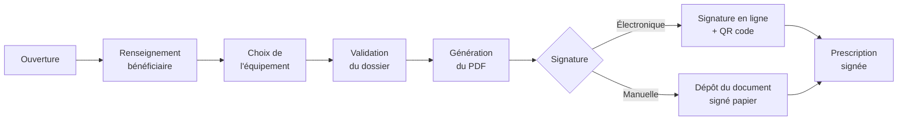

# Fonctionnement de la plateforme prescrip_pin40

Document de présentation du fonctionnement métier de l'application — principes, acteurs et parcours. Volontairement dépourvu de détails techniques (code, architecture, bugs) : pour cela, voir `docs/controllers/`.

---

## 1. Contexte et mission

**prescrip_pin40** est une application de gestion de **prescriptions numériques**, dans le cadre de la lutte contre l'illectronisme (dispositif national type *Aidants Connect / Pass Numérique*).

Le principe : une structure sociale identifie une personne en difficulté avec le numérique, et l'oriente vers un lieu de médiation numérique qui va l'accompagner et, si besoin, lui prêter du matériel. La **prescription** est le document qui formalise ce parcours, de la demande initiale jusqu'à la signature du document final par le bénéficiaire.

---

## 2. Les acteurs

| Rôle | Qui c'est | Ce qu'il fait sur la plateforme |
|---|---|---|
| **Prescripteur** | Structure sociale (association, service social, mairie...) qui identifie le besoin | Repère un bénéficiaire, initie sa prescription |
| **Médiateur numérique** | Structure qui accompagne concrètement le bénéficiaire | Complète la prescription, choisit l'équipement, accompagne jusqu'à la signature |
| **Administrateur** | Pilotage du dispositif à l'échelle d'un périmètre | Supervise les prescriptions, gère structures et membres |
| **Super-administrateur** | Pilotage global | Toutes les capacités d'un administrateur, plus la gestion des comptes administrateurs eux-mêmes |

Chaque compte membre est rattaché à une **structure** (le prescripteur ou le lieu de médiation), et chaque rôle ne voit que ce qui le concerne : un prescripteur ne voit que ses propres bénéficiaires et prescriptions, un médiateur celles de sa structure de médiation, un administrateur a une vue d'ensemble.

---

## 3. Les structures

Une **structure** représente un organisme (prescripteur ou lieu de médiation) : nom, adresse, contacts, et un membre responsable qui reçoit le rôle correspondant (prescripteur, médiateur ou administrateur) à la création.

La liste des structures est présentée avec une **carte géographique** montrant leur implantation, utile pour visualiser la couverture territoriale du dispositif.

---

## 4. Le cycle de vie d'une prescription

C'est le cœur du fonctionnement de l'application. Une prescription avance par étapes, chaque étape ne pouvant être franchie que par le rôle habilité à le faire.

### Étape par étape

1. **Ouverture** — Un prescripteur (ou un médiateur, ou un administrateur pour le compte d'une structure) crée la prescription et sélectionne le bénéficiaire concerné.
2. **Renseignement** — Les informations sur la situation du bénéficiaire, ses compétences numériques de départ, sont complétées.
3. **Choix de l'équipement** — Le médiateur (ou l'administrateur) sélectionne, parmi le matériel disponible, celui qui sera prêté au bénéficiaire. L'équipement choisi devient indisponible pour les autres prescriptions tant qu'il n'est pas rendu.
4. **Validation du dossier** — Le dossier est validé, la prescription est prête à être formalisée.
5. **Génération du PDF** — Le document de prescription est généré automatiquement à partir des informations saisies.
6. **Signature** — Deux façons d'obtenir la signature du bénéficiaire :
   - **Signature électronique** : une demande de signature est envoyée à un service dédié, le bénéficiaire signe en personne via un lien ou un QR code affiché à l'écran (le dispositif ne collecte pas d'adresse email des bénéficiaires).
   - **Dépôt manuel** : si la signature électronique n'est pas utilisée, le document signé sur papier peut être scanné et déposé directement sur la plateforme.
7. **Prescription signée** — Une fois signée (électroniquement ou déposée manuellement), la prescription est classée comme finalisée et apparaît dans les listes de prescriptions traitées.

### Chaque rôle a un pouvoir d'action différent selon l'étape

- Un **prescripteur** peut ouvrir une prescription et la faire avancer jusqu'à la partie qui le concerne (renseignements initiaux).
- Un **médiateur** intervient ensuite pour le choix de l'équipement et la validation.
- Un **administrateur/super-administrateur** peut intervenir à n'importe quelle étape et débloquer une situation si besoin.

---

## 5. Recherche et suivi des prescriptions

Chaque acteur dispose d'une **liste de ses prescriptions**, filtrée automatiquement selon son rôle et sa structure, avec une recherche par référence ou par structure. Un administrateur peut consulter l'ensemble des prescriptions du dispositif, avec un focus particulier sur celles déjà signées.

---

## 6. Les bénéficiaires

Les personnes accompagnées sont enregistrées comme **bénéficiaires**, avec leurs informations de base (identité, tranche d'âge, situation) et un **référent** — la personne de la structure qui suit leur dossier. Un bénéficiaire peut être créé soit via une page dédiée, soit directement depuis le formulaire de création d'une prescription, pour aller plus vite.

La recherche de bénéficiaires est également filtrée par rôle et par structure, comme pour les prescriptions.

---

## 7. Les équipements

Le matériel prêté aux bénéficiaires (ordinateurs, tablettes...) est référencé dans un catalogue d'**équipements**, chacun ayant un statut de disponibilité. C'est dans ce catalogue que le médiateur puise lors de l'étape "Choix de l'équipement" d'une prescription.

---

## 8. Le tableau de bord

Après connexion, chaque utilisateur arrive sur un **tableau de bord** qui synthétise, selon son rôle :
- ses bénéficiaires,
- ses prescriptions en cours et déjà signées,
- les équipements disponibles.

C'est le point d'entrée principal de l'application au quotidien.

---

## 9. Gestion des membres et des accès

Les administrateurs et super-administrateurs peuvent créer des comptes (prescripteurs, médiateurs, administrateurs), les regrouper par structure, réinitialiser un mot de passe, ou supprimer un membre — cette dernière action étant réservée aux rôles admin/super-admin et systématiquement confirmée par une fenêtre de validation pour éviter les suppressions accidentelles.

---

## 10. Pages publiques

Une partie du site est accessible sans connexion : présentation du dispositif de don de matériel, mentions légales, et page de contact.

---

## En résumé

La plateforme organise un parcours en trois temps — **repérer** (prescripteur), **accompagner** (médiateur), **piloter** (administration) — autour d'un objet central, la prescription, qui trace tout le parcours du bénéficiaire jusqu'à la signature du document final, avec un choix entre signature électronique et dépôt manuel selon les besoins du terrain.
